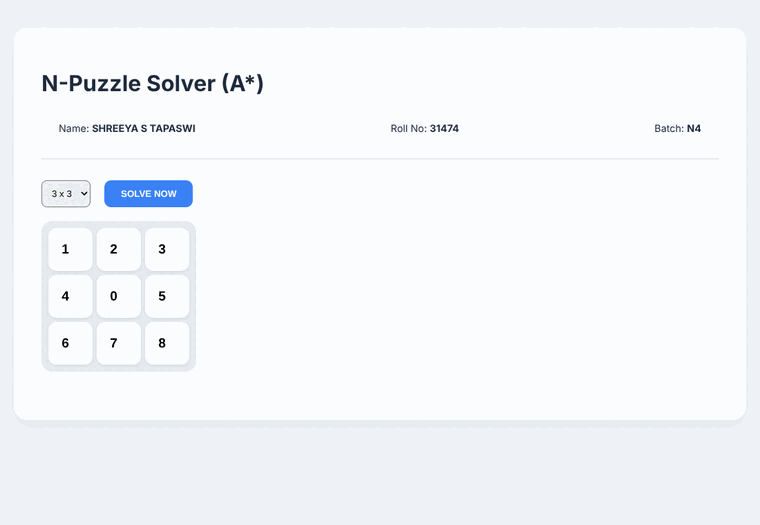
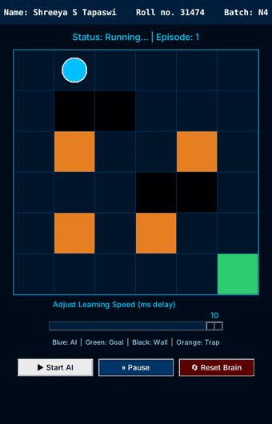
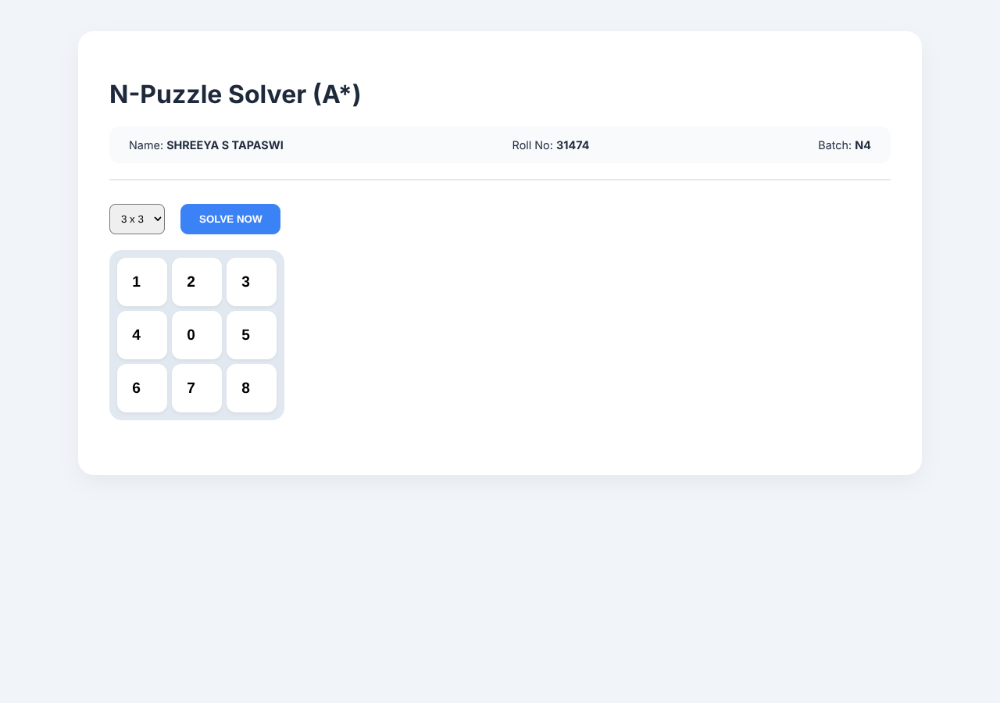
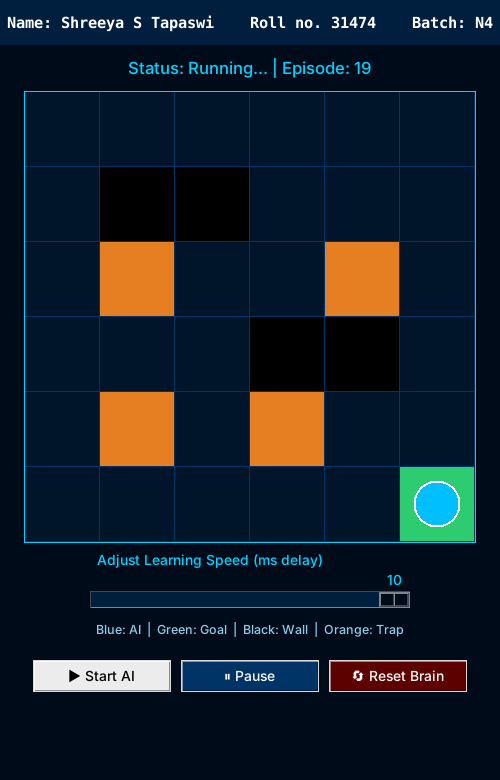

# PICT Coursework Labs: AI, Data Warehousing & Mining, and Smart Systems


A collection of lab assignments from my Computer Engineering coursework at **Pune Institute of Computer Technology (PICT)**. It covers three subjects:

| Subject | Folder | What's inside |
|---|---|---|
| Artificial Intelligence | [`Artificial Intelligence`](Artificial%20Intelligence) | A\* sliding-tile solver, Minimax / Alpha-Beta Tic-Tac-Toe, CSP map colouring, Q-learning maze agent, fuzzy-logic traffic controller |
| Data Warehousing & Mining | [`Data Warehouse and Mining`](Data%20Warehouse%20and%20Mining) | Preprocessing, loan-approval classifiers, Apriori market-basket analysis, an automobile-sales data warehouse (ETL + OLAP) |
| Data Analytics for Smart & Sustainable Systems (DASSS) | [`DASSS`](DASSS) | Crop-yield prediction, smart-home energy classification, irrigation water-data cleaning |

**Author:** Shreeya S. Tapaswi · Roll No. 31474 · Batch N4 · [GitHub profile](https://github.com/ShreeyaTapaswi)

---

## Table of contents

1. [Live demos](#live-demos)
2. [Repository structure](#repository-structure)
3. [Quick start](#quick-start)
4. [Artificial Intelligence](#1-artificial-intelligence)
5. [Data Warehousing & Mining](#2-data-warehousing--mining)
6. [DASSS](#3-dasss-data-analytics-for-smart--sustainable-systems)
7. [Datasets](#datasets)
8. [Troubleshooting](#troubleshooting)

---

## Live demos

Recorded from the actual programs in this repository.

| Sliding-tile puzzle (A\*) | Tic-Tac-Toe (Minimax) | Maze agent (Q-learning) |
|:---:|:---:|:---:|
|  |  |  |
| Solves the default 3×3 board in 14 moves and lets you step through them. | You play **O**; the agent plays **X** with alpha-beta pruning. | Episode counter climbs as the agent learns a route to the green goal. |

---

## Repository structure

```
PICT-AI-DWM-Smart-Systems-Labs/
├── Artificial Intelligence/
│   ├── N×N Sliding Tile Puzzle Solver/                      # Flask + A*
│   │   ├── 31474_Assignment-1.py
│   │   └── TestCases/                                       # screenshots
│   ├── Intelligent Tic-Tac-Toe Agent Using Minimax and Alpha-Beta Pruning/
│   │   ├── 31474_Assignment-2.py                            # Tkinter
│   │   └── TestCase/
│   ├── Map Coloring CSP/                                    # Flask + vis-network
│   │   ├── 31474_Assignment-3.py
│   │   └── TestCases/
│   ├── AI Agent Reinforcement Learning/                     # Tkinter + Q-learning
│   │   ├── 31474_Assignment-4.py
│   │   └── TestCases/
│   └── Intelligent Traffic Control System/
│       ├── 31474_AIL_Mock-1.py                              # CLI map colouring (CSP)
│       ├── TestCase-*_31474_Mock-1.png
│       └── Mock-2_31474/
│           ├── 31474_AIL_Mock-2.py                          # Mamdani fuzzy traffic control
│           └── Screenshot from 2026-10-30 *.png
├── Data Warehouse and Mining/
│   ├── Preprocessing_Normalization_Transformation.ipynb
│   ├── Loan_Approval_Classifiers.ipynb
│   ├── Apriori Algorithm_SyntheticData.ipynb
│   ├── Apriori Algorithm_RealData.ipynb
│   ├── Data_Cube_Data_Mart_ETL_OLAP.pdf                     # report
│   └── Data_Cube_Data_Mart_ETL_OLAP.zip                     # datasets + ETL pipeline
├── DASSS/
│   ├── Crop_Yield_Prediction.ipynb
│   ├── Energy_Usage_Prediction.ipynb
│   └── Water_Consumption_Prediction_for_Smart_Irrigation.ipynb
├── assets/
│   ├── demos/                                               # GIF demos used above
│   └── screenshots/
├── requirements.txt
└── README.md
```

---

## Quick start

```bash
git clone https://github.com/ShreeyaTapaswi/PICT-AI-DWM-Smart-Systems-Labs.git
cd PICT-AI-DWM-Smart-Systems-Labs

python -m venv venv
source venv/bin/activate          # Windows: venv\Scripts\activate
pip install -r requirements.txt
```

**Tkinter** (used by the Tic-Tac-Toe and maze apps) ships with Python on Windows and macOS. On Ubuntu/Debian install it with `sudo apt install python3-tk`.

**Python version:** tested on Python 3.12. Keep `pandas<3` (already set in `requirements.txt`); see [Troubleshooting](#troubleshooting).

---

## 1. Artificial Intelligence

All scripts live in [`Artificial Intelligence`](Artificial%20Intelligence). Each file starts with a header giving the problem statement.

### 1.1 N×N Sliding Tile Puzzle Solver (A\*)

[`31474_Assignment-1.py`](Artificial%20Intelligence/N%C3%97N%20Sliding%20Tile%20Puzzle%20Solver/31474_Assignment-1.py) is a small Flask web app. You choose a 3×3 or 4×4 grid, edit the board in the browser, press **SOLVE NOW**, and step through the solution with **BACK / NEXT** or by clicking any entry in the step log.

* **Algorithm:** A\* search with the **Manhattan-distance** heuristic (admissible, so solutions are optimal), using a priority queue (`heapq`).
* **Solvability check:** inversion-count test, so impossible boards are rejected with an "Unsolvable configuration" message instead of searching forever.
* **API:** `POST /solve` takes `{"board": [...], "n": 3}` and returns the move path.

```bash
cd "Artificial Intelligence/N×N Sliding Tile Puzzle Solver"
python 31474_Assignment-1.py
# open http://127.0.0.1:5000
```

<details>
<summary>Screenshots</summary>

| Start state | Solved (Step 14) | Unsolvable board detected |
|:---:|:---:|:---:|
|  |  |  |



</details>

### 1.2 Tic-Tac-Toe Agent (Minimax + Alpha-Beta Pruning)

[`31474_Assignment-2.py`](Artificial%20Intelligence/Intelligent%20Tic-Tac-Toe%20Agent%20Using%20Minimax%20and%20Alpha-Beta%20Pruning/31474_Assignment-2.py) is a Tkinter game where you play **O** against an agent that plays **X**. The agent picks moves with **Minimax** and prunes branches with **Alpha-Beta**, so it never loses; the best you can do is draw. A dialog announces the result ("Draw! Perfect Tactics." or "AI Won (Optimal Decision)") and **Restart Encounter** resets the board.

```bash
cd "Artificial Intelligence/Intelligent Tic-Tac-Toe Agent Using Minimax and Alpha-Beta Pruning"
python 31474_Assignment-2.py
```

<details>
<summary>Screenshots</summary>

| New game | Draw | AI wins |
|:---:|:---:|:---:|
|  |  |  |

</details>

### 1.3 Map Colouring (Constraint Satisfaction Problem)

[`31474_Assignment-3.py`](Artificial%20Intelligence/Map%20Coloring%20CSP/31474_Assignment-3.py) is a Flask app for colouring a map of Indian states (or any region you define). Add states, connect neighbouring borders, and press **SOLVE**. The graph is drawn with vis-network and each state gets a colour so that no two neighbours match.

* **Model:** variables = states, domain = 5 colours, constraint = adjacent states must differ.
* **Solver:** recursive backtracking (`MapColoringCSP.backtrack`).
* **API:** `POST /solve` takes `nodes` and `edges` and returns a colour assignment.
* **Needs internet** in the browser: Tailwind CSS and vis-network are loaded from CDNs.

```bash
cd "Artificial Intelligence/Map Coloring CSP"
python 31474_Assignment-3.py
# open http://127.0.0.1:5000
```

<details>
<summary>Screenshots</summary>

| South and west India | East India |
|:---:|:---:|
|  |  |

</details>

### 1.4 Maze Navigation with Q-Learning

[`31474_Assignment-4.py`](Artificial%20Intelligence/AI%20Agent%20Reinforcement%20Learning/31474_Assignment-4.py) trains a Q-learning agent on a **6×6 grid**. The agent starts at (0, 0), must reach the goal at (5, 5), avoids black **walls** and orange **traps**, and learns from rewards and penalties over repeated episodes.

| Hyperparameter | Value |
|---|---|
| Learning rate (alpha) | 0.1 |
| Discount factor (gamma) | 0.9 |
| Exploration rate (epsilon) | 0.1 |

Controls: **Start AI**, **Pause**, **Reset Brain** (clears the Q-table), and a slider that sets the delay between steps (slide right for faster training).

```bash
cd "Artificial Intelligence/AI Agent Reinforcement Learning"
python 31474_Assignment-4.py
```

<details>
<summary>Screenshots</summary>

| Training, early episode | Training, later episode |
|:---:|:---:|
|  |  |



</details>

### 1.5 Intelligent Traffic Control System (AIL Mock exams)

This folder holds two programs from the AIL mock exams.

**Mock-2: Mamdani fuzzy-logic traffic controller** ([`31474_AIL_Mock-2.py`](Artificial%20Intelligence/Intelligent%20Traffic%20Control%20System/Mock-2_31474/31474_AIL_Mock-2.py)). Enter the vehicle count (0 to 80) for North, South, East and West. Each count is fuzzified with triangular membership functions into **Low / Medium / High** traffic, and the controller outputs a recommended green-signal time per direction, then reports the busiest direction. You can analyse several cycles in one run. Requires `numpy`.

```bash
cd "Artificial Intelligence/Intelligent Traffic Control System/Mock-2_31474"
python 31474_AIL_Mock-2.py
```

Sample run (North 10, South 40, East 70, West 5):

```
Direction       Vehicles        Green Time
North           10              17.16 sec
South           40              36.97 sec
East            70              52.48 sec
West            5               16.6 sec

Highest Traffic Direction: East
Recommended Green Time: 52.48 seconds
```

**Mock-1: map colouring from the terminal** ([`31474_AIL_Mock-1.py`](Artificial%20Intelligence/Intelligent%20Traffic%20Control%20System/31474_AIL_Mock-1.py)). A console version of the CSP map-colouring problem: enter the states, their neighbours and the available colours, and it prints a valid colouring.

```bash
cd "Artificial Intelligence/Intelligent Traffic Control System"
python 31474_AIL_Mock-1.py
```

<details>
<summary>Screenshots</summary>

| Mock-1 terminal run | Mock-2 traffic report |
|:---:|:---:|
|  |  |

</details>

---

## 2. Data Warehousing & Mining

All notebooks are in [`Data Warehouse and Mining`](Data%20Warehouse%20and%20Mining). They were written in Google Colab, so the quickest way to run them is the **Open in Colab** buttons below. They also run locally in Jupyter once the datasets are in place (see [Datasets](#datasets)).

### 2.1 Data Preprocessing and Normalization

[`Preprocessing_Normalization_Transformation.ipynb`](Data%20Warehouse%20and%20Mining/Preprocessing_Normalization_Transformation.ipynb) [](https://colab.research.google.com/github/ShreeyaTapaswi/PICT-AI-DWM-Smart-Systems-Labs/blob/main/Data%20Warehouse%20and%20Mining/Preprocessing_Normalization_Transformation.ipynb)

Cleans the **Titanic** dataset (loaded from Seaborn, no download needed): handles missing values, encodes categorical columns, converts data types, and applies Min-Max normalization.

### 2.2 Loan Approval Classifiers

[`Loan_Approval_Classifiers.ipynb`](Data%20Warehouse%20and%20Mining/Loan_Approval_Classifiers.ipynb) [](https://colab.research.google.com/github/ShreeyaTapaswi/PICT-AI-DWM-Smart-Systems-Labs/blob/main/Data%20Warehouse%20and%20Mining/Loan_Approval_Classifiers.ipynb)

Predicts whether a bank loan is **Approved** or **Rejected** from applicant details (income, employment, loan amount and term, CIBIL score, dependents, asset values). The dataset has 4,269 applications; the test split holds 854 (323 rejected, 531 approved).

| Model | Accuracy | Precision | Recall | F1 | ROC-AUC |
|---|---:|---:|---:|---:|---:|
| **Random Forest** | **98.13%** | 98.49% | 98.49% | 98.49% | 99.86% |
| Decision Tree | 97.89% | 98.31% | 98.31% | 98.31% | 97.76% |
| Naïve Bayes | 94.73% | 95.68% | 95.86% | 95.77% | 97.65% |
| SVM | 94.61% | 95.84% | 95.48% | 95.66% | 98.76% |
| Logistic Regression | 91.45% | 92.10% | 94.35% | 93.21% | 97.26% |
| KNN | 89.58% | 91.08% | 92.28% | 91.67% | 96.24% |

Random Forest is the best model on this test set.

### 2.3 Apriori: Market-Basket Analysis

Two notebooks apply the Apriori algorithm (`mlxtend`) to find items that are bought together.

**Synthetic bookstore data** ([`Apriori Algorithm_SyntheticData.ipynb`](Data%20Warehouse%20and%20Mining/Apriori%20Algorithm_SyntheticData.ipynb)) [](https://colab.research.google.com/github/ShreeyaTapaswi/PICT-AI-DWM-Smart-Systems-Labs/blob/main/Data%20Warehouse%20and%20Mining/Apriori%20Algorithm_SyntheticData.ipynb)
100 book-purchase transactions, **minimum support 40%** and **minimum confidence 60%**. Frequent itemsets found: Data Science, Machine Learning, Python Programming, SQL for Beginners, and the pair (Python Programming, SQL for Beginners). The one rule that passes both thresholds:

| Rule | Support | Confidence | Lift |
|---|---:|---:|---:|
| SQL for Beginners → Python Programming | 40% | 66.7% | 0.95 |

**Real supermarket data** ([`Apriori Algorithm_RealData.ipynb`](Data%20Warehouse%20and%20Mining/Apriori%20Algorithm_RealData.ipynb)) [](https://colab.research.google.com/github/ShreeyaTapaswi/PICT-AI-DWM-Smart-Systems-Labs/blob/main/Data%20Warehouse%20and%20Mining/Apriori%20Algorithm_RealData.ipynb)
5,175 transactions across 119 items. Mineral water is the most frequent item (1,551 transactions, about 30%). With **minimum support 1%** the notebook finds 436 frequent itemsets, and with **minimum confidence 30%** it generates 150 association rules, for example *spaghetti → mineral water* (support 8.5%, confidence 37.0%, lift 1.24).

### 2.4 Data Cube, Data Mart, ETL and OLAP

Case Study 10: **Automobile Sales (retail industry) data warehouse.**

* Report: [`Data_Cube_Data_Mart_ETL_OLAP.pdf`](Data%20Warehouse%20and%20Mining/Data_Cube_Data_Mart_ETL_OLAP.pdf) (8 pages: ETL pipeline, database before and after ETL, and OLAP queries).
* Source files: [`Data_Cube_Data_Mart_ETL_OLAP.zip`](Data%20Warehouse%20and%20Mining/Data_Cube_Data_Mart_ETL_OLAP.zip) contains the raw CSVs (auto sales, customers, dates, dealership sales, finance records, online bookings, service records, spare-parts inventory, vehicles), the dimension and fact tables (`Dim_Customer`, `Dim_Date`, `Dim_Dealership`, `Dim_Vehicle`, `Fact_Sales`), the ETL pipeline `31474_DWML_A2_etl.hpl`, and MySQL connection metadata.
* **OLAP operations covered:** roll-up (by region, by quarter), drill-down (year to month, vehicle type to model), slice (SUV only, Maharashtra only), dice (hatchback and Q1), and pivot (vehicle type against fuel type, quarter against vehicle type).

---

## 3. DASSS: Data Analytics for Smart & Sustainable Systems

Notebooks are in [`DASSS`](DASSS).

### 3.1 Crop Yield Prediction

[`Crop_Yield_Prediction.ipynb`](DASSS/Crop_Yield_Prediction.ipynb) [](https://colab.research.google.com/github/ShreeyaTapaswi/PICT-AI-DWM-Smart-Systems-Labs/blob/main/DASSS/Crop_Yield_Prediction.ipynb)

Combines three datasets (crop data 19,689 × 9, state-level soil nutrients 30 × 5, annual weather 720 × 5) covering Indian states from 1997 to 2020, and predicts crop yield. It includes an interactive `ipywidgets` prediction form.

| Model | MAE | RMSE | R² |
|---|---:|---:|---:|
| **Random Forest** | **0.1868** | **0.3297** | **0.8984** |
| Decision Tree | 0.2706 | 0.4501 | 0.8108 |
| Linear Regression | 0.4204 | 0.5588 | 0.7083 |

### 3.2 Smart-Home Energy Usage Classification

[`Energy_Usage_Prediction.ipynb`](DASSS/Energy_Usage_Prediction.ipynb) [](https://colab.research.google.com/github/ShreeyaTapaswi/PICT-AI-DWM-Smart-Systems-Labs/blob/main/DASSS/Energy_Usage_Prediction.ipynb)

Uses the UCI **Appliances Energy Prediction** dataset (19,735 observations, 28 features, 10-minute readings over about 4.5 months) to classify consumption as **Low, Medium or High**. The Decision Tree, Naïve Bayes and Logistic Regression models are implemented from scratch, and the notebook also analyses high-consumption hours.

| Model (from scratch) | Accuracy | Precision | Recall | F1 |
|---|---:|---:|---:|---:|
| **Decision Tree** | **61.67%** | 60.17% | 61.67% | 59.56% |
| Logistic Regression | 58.22% | 56.37% | 58.22% | 56.23% |
| Naïve Bayes | 53.20% | 52.42% | 53.20% | 52.22% |

The "Medium" class is the hardest to separate (Decision Tree recall 0.29 versus 0.78 for "Low" and 0.74 for "High").

### 3.3 Water Consumption Data Preparation for Smart Irrigation

[`Water_Consumption_Prediction_for_Smart_Irrigation.ipynb`](DASSS/Water_Consumption_Prediction_for_Smart_Irrigation.ipynb) [](https://colab.research.google.com/github/ShreeyaTapaswi/PICT-AI-DWM-Smart-Systems-Labs/blob/main/DASSS/Water_Consumption_Prediction_for_Smart_Irrigation.ipynb)

Prepares a 1,000-record irrigation dataset (district, crop, irrigation method, water consumption and water availability in litres per hectare). It covers descriptive statistics, unique-value counts, missing-value detection and handling, duplicate removal, and outlier detection with box plots.

---

## Datasets

The notebooks that need external data do not bundle it. Download it first, then upload it when the notebook's file picker appears (Colab) or point the notebook's path to your local copy.

| Notebook | Dataset | Source |
|---|---|---|
| Preprocessing | Titanic | Built into Seaborn (`sns.load_dataset("titanic")`) |
| Loan Approval | Loan Approval Prediction Dataset | [Kaggle](https://www.kaggle.com/datasets/architsharma01/loan-approval-prediction-dataset) |
| Crop Yield | Crop yield with soil and weather data | [Kaggle](https://www.kaggle.com/datasets/anshumish/crop-yield-data-with-soil-and-weather-dataset) |
| Energy Usage | Appliances Energy Prediction | [UCI ML Repository](https://archive.ics.uci.edu/dataset/374/appliances+energy+prediction) |
| Apriori (synthetic) | Generated inside the notebook | none needed |
| Apriori (real) and Water | CSV files uploaded in the notebook | not bundled in this repository |
| Data Cube / ETL | CSVs and ETL pipeline | included in [`Data_Cube_Data_Mart_ETL_OLAP.zip`](Data%20Warehouse%20and%20Mining/Data_Cube_Data_Mart_ETL_OLAP.zip) |

---

## Troubleshooting

* **`ModuleNotFoundError: No module named 'tkinter'`**: install Tkinter (`sudo apt install python3-tk` on Ubuntu/Debian).
* **Map-colouring page shows unstyled text and no graph**: the page loads Tailwind CSS and vis-network from CDNs, so the browser needs internet access.
* **`IntCastingNaNError` in the preprocessing notebook**: this happens with `pandas` 3.x, where `df['age'].fillna(..., inplace=True)` no longer updates the DataFrame. Use `pip install "pandas<3"` (as in `requirements.txt`), or change those lines to `df['age'] = df['age'].fillna(df['age'].mean())` (same pattern for `embarked` and `embark_town`).
* **`google.colab` import error when running locally**: the Colab-only upload cells (`from google.colab import files`) can be skipped; load the CSV with `pd.read_csv("path/to/file.csv")` instead.
* **Port 5000 already in use**: stop the other process, or change the port in the `app.run(...)` call at the bottom of the script.

---

## Author

**Shreeya S. Tapaswi**, Roll No. 31474, PICT, Pune. [github.com/ShreeyaTapaswi](https://github.com/ShreeyaTapaswi)
